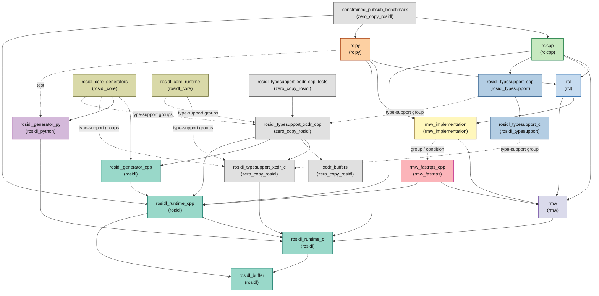

# REP-0157 Rolling migration

## Starting point

- The target is the current [REP-0157 draft](../reps/_posts/rep-0157:2026.md)
  (last updated at `reps` commit `c0c5f20`), not a straight Jazzy port.
- Infrastructure is at `zero_copy_rosidl` commit `83c3950`. The ten ROS
  repositories listed in [Rolling's patched manifest](code/core/.repos/rolling/patched.repos)
  are clean, on `zero-copy-rolling`, and at their manifest pins. Baseline
  builds have not yet been verified.
- The Jazzy PoC is under `code/core/jazzy/ros2/`; its corresponding
  `zero-copy-jazzy` branches are also available in the Rolling checkouts.
  The shared [XCDR packages](code/rosidl_typesupport_xcdr/) and
  [benchmark](code/constrained_pubsub_benchmark/) are tracked by this repo.
- `code/core/` checkouts are separate, ignored Git repositories. Track their
  changes and commits separately; update the Rolling manifest to reproducible
  ported revisions when they are available. `code/import.py` skips existing
  checkouts and does not update them.

Work bottom-up in the order below. Each checkbox is a separately verifiable
update; mark it complete only when its stated checks pass. A step is complete when all its
checkboxes pass; stop after each step and ask the user to commit to git.

## Contracts to preserve

- Existing member-based messages and APIs remain available. New views use
  method-based access and the `views` namespace or language equivalent.
- A view may own storage or borrow it. A borrowed view and its member
  references must not outlive the loan. Exactly one of destroy or release
  consumes the view; querying storage does not.
- Endpoint constraints are the baseline; a per-loan context may tighten but
  not loosen it. Publisher and subscriber baselines are independent. An
  omitted per-take constraint does not remove the subscription baseline.
- Storage comprises one or more regions. Start with CPU-backed XCDRv1; do not
  invent portable device-attribute or synchronization semantics. Unsupported
  context requirements and loans must be reported, not silently ignored.
- The REP does not standardize a wire format or type-support operation table.
  The PoC's XCDR table and in-place compaction are implementation choices.
  Compatible ordinary ROS communication and copy paths must continue working.

## Package dependencies

This is a simplified graph of the current Rolling
workspace: each node names a package and its repository, and colors identify
repositories. Arrows point from a package to its dependency. Dotted arrows
mark test dependencies or dependencies selected through package groups and
conditions. Build, runtime and test dependencies are included; unrelated
packages and transitive edges are omitted.



For example, `rosidl_generator_tests` selects interface packages such as
`action_msgs`, which depend on `rosidl_core_generators`. Its type-support
groups include the XCDR packages, so those packages can be selected even when
testing ordinary message generation.

## Ordered work

### 1. Contracts and plain-message adapters

- [x] Add C region, constraint and context descriptors and C++
  region and constraint helpers; compile and test their basic use.
- [x] Generate method-based views adapting owned, borrowed and const plain
  messages; test ownership, mutability, moves and const-rvalue ownership.
- [x] Generate nested-message and sequence accessors and constraint checks;
  test the current plain-message cases and ordinary-message builds.
- [x] Remove the unnecessary `ament_cmake_ros` dependency from the shared XCDR
  C package and declare its GoogleTest dependency; build and test on Jazzy.
- [x] Complete the lifetime interfaces for querying and
  consuming views without requiring an XCDR representation. Specify ownership
  and invalidation for borrowed storage and member references; test the
  contract independently of middleware.
- [x] Test plain-message constraints for nested and bounded strings/sequences,
  zero/unset limits and rejected looser bounds, plus lifetime invalid-use
  cases. Do not claim that plain-message adapters make storage transferable
  without copying.

Implementation commits: `rosidl` `13dce8b5` and `zero_copy_rosidl` `427c25f`.

Starting points: Jazzy `rosidl_runtime_{c,cpp}` and
`rosidl_generator_cpp/resource/*experimental*`.

### 2. Region-backed primitives and XCDR buffers

- [x] Port CPU region-backed scalar and fixed-array primitives using C++20
  `std::span`/STL facilities and the existing `rosidl_runtime_cpp::views`
  namespace (not the Jazzy `experimental` namespace); test mutable
  and const access, bounds, invalid regions and owning versus borrowed storage.
- [x] Port region-backed string and sequence primitives; test nested elements,
  capacity, malformed or undersized regions and lifetime independently of
  generated messages and middleware.
- [x] Integrate storage exposure with `rosidl::Buffer` and Rolling's backend
  API; test owned and borrowed CPU storage and explicitly reject unsupported
  access rather than assuming device-memory semantics.
- [x] Build `xcdr_buffers` on Rolling with its declared dependencies and run
  its layout, parser, accessor and Fast CDR interoperability tests. Check
  malformed input and preserve Jazzy compatibility in shared packages.

Implementation commits: `rosidl` `8afa0094`.

### 3. Generated region-backed views and XCDRv1 type support

The views can be built against region-backed primitives independently of
XCDR, but the XCDR generator needs their view and storage interfaces.
Verifying an XCDR-backed view requires both. Integrate and test them together
after Step 2 rather than requiring that verification before XCDR is ported.

- [x] Adapt the XCDR C interface to the Rolling constraint contracts while
  retaining Jazzy compatibility; build and run its callback tests on both.
- [x] Generate method-based views backed by the Step 2 primitives, alongside
  ordinary messages and plain-message adapters. Test nested fields, bounds,
  ownership and explicit mutability over controlled regions.
- [x] Port XCDR C++ layout, construction and casting for those views; test
  compatible representations and reject malformed or undersized storage.
- [x] Port storage query, destroy and release; test non-consuming queries,
  exactly-once consumption and simulated loan lifetime. Actual middleware
  loan return is verified in Steps 4 through 6.
- [x] Port XCDR serialization and compaction and test ordinary-message copy
  interoperability. Keep format-specific logic in this implementation, not
  a purported format-independent ABI.
- [x] Port necessary `rosidl_typesupport` dispatch and `rosidl_core`
  integration; test ordinary support and verify constrained handles retain
  their constraints and derived metadata.

Implementation commits: `rosidl` `8af12f40`, `rosidl_typesupport` `0d21bb9`,
`rosidl_core` `22abb46` and `zero_copy_rosidl` `8b0a212`. These include
follow-up fixes and tests for the Step 2 primitives and XCDR buffers.

Step 5 mixed-transport testing exposed a wide-string wire mismatch inherited
from the Jazzy prototype. Rolling region views now use 32-bit storage slots
with UTF-16 code-unit proxy access, and Rolling XCDR uses the ordinary Fast DDS
encoding: a character-count prefix and 32-bit code units without a terminator.
Mixed ordinary/view Fast DDS loans are tested in both directions, including
embedded nulls and subsequent fields. A wide view does not expose a contiguous
`char16_t *`, `std::u16string_view`, or `c_str()`; `to_string()` explicitly
copies. Borrowed substrings and references share the view's storage lifetime.

The generated region storage and `WideString::ExternalStorage` expose
`StringStorage<uint32_t>`, so the current storage API is not backend-neutral.
The checked Zenoh implementation uses Fast RTPS serialization callbacks for
ordinary messages, whereas the checked Cyclone DDS serializer uses a byte
count and 16-bit code units. Neither middleware has been integration-tested
with these region views. Matching an encoding alone does not establish region
loan support: storage lifetime, ownership, alignment, endianness and code-unit
constraints also matter. Other backends require explicit integration; no
automatic conversion or fallback is provided. Investigate separating the
logical view API from its storage policy when implementing another backend.
Ordinary messages retain their existing middleware serialization paths.

Jazzy experimental generation retains its original representation and remains
incompatible with ordinary Fast DDS wide strings; its passing self-round-trip
tests do not establish interoperability.

Starting points: `code/rosidl_typesupport_xcdr/` and the Jazzy
`rosidl_typesupport` and `rosidl_core` branches.

### 4. Middleware context plumbing

- [x] Add context-aware endpoint creation and borrow/take operations in `rmw`;
  test unsupported requirements and retained context/constraint lifetime.
- [x] Forward the operations through `rmw_implementation`; test dispatch and
  preserve old entry points.
- [x] Expose the operations in `rcl`; test existing APIs, independent endpoint
  baselines, tighter and rejected looser loans, and null per-loan context.

Context-aware middleware behavior is exercised with a simulated implementation,
including copied type-specific constraints and independent endpoint baselines.
Actual context-aware Fast DDS middleware loans are implemented and verified
in Step 5. The dispatcher preserves legacy calls for null contexts when a
backend lacks the new symbols, in both runtime-selected and fixed-backend builds.

Implementation commits: `rmw` `7852434`, `rmw_implementation` `318919b`,
`rcl` `8fc2083` and `zero_copy_rosidl` `f066f92`.

### 5. Fast DDS transport

- [x] Port `rmw_fastrtps` XCDR type support against the pinned Rolling Fast
  DDS APIs; test compatible casts and reject incompatible representations.
- [x] Port publisher endpoint and loan handling, including backing-region
  correlation and in-place finalization; test return and error cleanup.
- [x] Port subscriber loans for plain and non-plain samples; test loan return,
  error cleanup and ordinary serialization/copy interoperability. Unsupported
  zero-copy is not evidence that an automatic fallback exists.

Starting point: Jazzy `rmw_fastrtps_shared_cpp` `XcdrTypeSupport` and loan paths.

Rolling port considerations, verified against the pinned Fast DDS source:

- Blanket string/total-size constraints and contexts on ordinary type support
  are rejected; no automatic copy fallback is implied.
- Type-support contexts belong to individual DataWriters and DataReaders and
  must be installed before the entity is enabled. Endpoint creation must
  account for Fast DDS auto-enabling children, including when a filtered
  DataReader is recreated.
- A plain reader loan exposes a pointer after the encapsulation header, not
  the received payload length. The Jazzy prototype uses the constrained
  allocation size as a parser bound; that is not necessarily the actual
  received length, so it must not be used to validate arbitrary samples.
  A non-plain loan invokes deserialization with the actual payload length,
  but Fast DDS's loan manager does not propagate the deserializer's return
  value. Any holder-based implementation must retain and check its own
  failure state and return the DDS loan on failure.
- A writer loan retains the full allocated payload length after in-place
  compaction: the pinned Fast DDS writer forwards the loaned payload without
  updating its length. Mixed ordinary/view tests pass, but shortened samples
  still transmit the zero-initialized trailing allocation.
- The region-loan capability flag changes the shared XCDR callback table.
  Old generated tables are not ABI-compatible with the new backend; rebuild
  all producers and consumers together. A versioned capability mechanism is
  needed before promising binary compatibility upstream.
- Region type support does not provide key hashing; generated keyed region
  types explicitly reject context-aware endpoints. Empty messages interoperate
  in both directions. Region endpoints do not register a DDS TypeObject.
  Filtering fails without replacing the reader if no TypeObject is already
  registered; an ordinary endpoint can register it.
- Reader replacement is prepared before the original is destroyed, with
  rollback tested for graph-add failure. Writer-history exhaustion is tested
  to fail publication and return the loan for reuse.

Implementation commits: `rosidl` `79389e69`, `rmw_fastrtps` `be3d4f5` and
`zero_copy_rosidl` `7a07901`.

### 6. C++ client library

- [x] Port `rclcpp` endpoints and publisher loans for views and contexts;
  test existing APIs and return-on-error.
- [x] Port subscription/executor support; test callback and loan lifetime.
- [x] Demonstrate C++ to C++ publisher and subscriber loans, mixed loan/copy
  paths and ordinary-message communication.

`Node::create_publisher<View>(topic, qos, constraints)` and
`Node::create_subscription<View>(topic, qos, callback, constraints)` create
dedicated region endpoints. A publisher loan is move-only, returns itself when
discarded, and can be published only by its originating publisher. A
per-borrow constraint may tighten the endpoint baseline. The subscription
callback receives a const view, optionally with `MessageInfo`; its view and
member references expire when the callback returns, including on exceptions.
Publisher loans can be returned after context shutdown.

Region endpoints require middleware loans and reject intra-process mode; there
is no copy fallback. Region subscriptions opt into loans when
`ROS_DISABLE_LOANED_MESSAGES` is unset, but honor an explicit setting. The
implemented API requires typed constraints and does not add region overloads
to the free-function or lifecycle-node factories. Fast DDS and the
single-threaded executor were exercised; other backends and executors have not
been integration-tested. Fast DDS consumes a valid publisher loan even on a
middleware publication failure; RCL rejects an invalid publisher before
dispatch, in which case the loan remains owned by the caller.

Implementation commits: `rcl` `be5eeb3`, `rclcpp` `4a15840b` and
`zero_copy_rosidl` `cb1bbe6`.

### 7. Python bindings and client library

- [x] Adapt `rosidl_python` generation and `MessageTypeBridge` to view APIs,
  constraints and lifetimes, reusing C++ XCDR; test ordinary Python messages.
- [x] Port `rclpy` context and loan handling; test cleanup and callback
  lifetime without changing ordinary Python messages.
- [x] Test C++ to Python, Python to C++, and Python to Python, including loan
  cleanup and subscriber callback lifetime. No separate CPython XCDR package
  is needed for the existing bridge approach.

Python region generation is opt-in: build each interface package and its
interface dependencies with `-DROSIDL_GENERATOR_PY_REGION_VIEWS=ON` and with
the C++ XCDR type support, `rosidl_runtime_cpython`, and pybind11 available.
The default is `OFF`; ordinary generated Python messages remain available.
Loanable types require the XCDR generator's `msg/experimental` interface
convention. Other generated views can be used as owned objects, but lack the
region-loan type support needed by endpoints.
For example, `pkg.msg.views.Example` is the region class and
`pkg.msg.Example` is the ordinary message. Service and action bindings remain
outside this step.

A region class has a `Constraints` type; use it as `type_specific` in
`rosidl_runtime_cpython.constraints.MessageConstraints` when creating an
endpoint or tightening a publisher borrow. String sizes use `<field>_size`,
sequence lengths use `<field>_length`, and nested sequence constraints use
`<field>_element`. Some nested types require explicit typed constraints even
when their fields are bounded. Publisher loans are acquired with
`publisher.borrow_loaned_message()` and consumed by
`publisher.publish_loaned_message(loan)`; a discarded or explicitly returned
loan is returned to the middleware. Publisher loans can also be returned
after context shutdown.

Generated views expose checked array and sequence wrappers with indexing,
assignment, `append` and `clear`; fixed arrays cannot be resized. Nested
fields and nested sequence elements can be assigned from field dictionaries.
Whole-container and nested-dictionary assignment can partially modify a
message if a later element or field is invalid. No borrowed raw buffer is
exported. Retained element views are invalidated when their container changes,
and all loan-derived views expire when their loan returns. Subscription views
are read-only and remain valid through a synchronous or awaited callback,
including cancellation and exceptions.

Fast DDS tests cover generated Python-to-Python and C++/Python loans in both
directions, cross-package nested views, ordinary-message interoperability,
constraints, and cleanup. Other middleware implementations have not been
integration-tested. Experimental `AsyncNode`, raw region
subscriptions and `wait_for_message` reject region views; the EventsExecutor's
copy-based take also rejects them. The tested executor is single-threaded.
The bridge capsule is a PoC C++ ABI, not a standardized binary interface;
rebuild its consumers together after changing the runtime headers.

Implementation commits: `rosidl_python` `263f282`, `rclpy` `20f0fa1` and
`zero_copy_rosidl` `2ec0683`.

### 8. Remaining language and service surface

- [x] Provide C view types and accessors alongside existing C messages.
- [x] Extend the view and constraint abstractions to service requests and
  responses; assess and implement the required client/middleware plumbing.
  The Jazzy topic PoC does not establish end-to-end service support, and its
  Python bridge excludes service/action constituents.
- [x] Test applicable C and service paths, including ordinary-message
  compatibility and ownership.

C plain-message adapters and opaque region accessors are generated alongside
existing messages. Plain adapter const qualification is shallow; region const
accessors do not expose mutable fields. Region accessors and type support are
provided by the generated C++ XCDR library. Typed C constraint builders
provide type-specific limits, including nested limits; destroy only root
builders returned by `create`, not borrowed nested handles. Constraints must
remain alive while used by a context. Loan-derived views, field pointers and
nested handles expire when the loan is returned; resizing a container also
invalidates its element views. Wide strings use copy accessors rather than
exposing backend storage as `uint16_t *`.

Request and response region views have separate constraints. RMW and RCL
provide context-aware client/service creation and borrow, send, take and
return operations. These endpoints require middleware support, do not fall
back to copying, and reject service introspection. Ordinary service events
continue to use ordinary message type support. The C++ `RegionClient` and
`RegionService` wrappers are explicitly polled; they are not registered with
an executor. Python service views and action views are not implemented here.

Fast DDS supports service loans and ordinary/region interoperability in both
directions. Send/return operations consume a valid view when indicated by
their in/out pointer, including some failures. Failed DDS reader returns or
writer discards retain backend loan tracking; endpoint finalization retries
pending cleanup and preserves the endpoint if it still fails. Tests cover C
and C++ service round trips through RCL, constraints, ownership, ordinary
interoperability, failed cleanup and retries. Other middlewares and executors
have not been integration-tested.

Implementation commits: `rosidl` `91b37710`, `rosidl_typesupport` `19fa75e`,
`rmw` `31e5b22`, `rmw_implementation` `1076d8b`, `rcl` `92fd07a`,
`rmw_fastrtps` `1cbf8d5`, `rclcpp` `5c8f6836`, and `zero_copy_rosidl`
`8541ac7`.

### 9. End-to-end verification

- [ ] Port the benchmark to the new APIs and Rolling; run its smoke test and
  representative C++/Python copy and loan cases. Verify the actual transport
  and storage path when claiming zero-copy; compare with ordinary ROS peers.
- [ ] Run relevant package tests and regression tests.
- [ ] Add a new section to this document with a comparison between the Jazzy PoC
  and the Rolling port, what's different, what's missing, why, what can change if
  we decide to go in a different direction.

### 10. Documentation

- [ ] Update the README, developer guides, Rolling manifests and CI/build
  instructions with verified commands and limitations.

## Development environment

Perform development builds, tests, and dependency installation in the matching
distribution's development container, not on the host. Edit the bind-mounted
sources from either environment. Use the Rolling development container for
this migration; use the Jazzy development container when checking Jazzy.

The Rolling container is selected explicitly:

```bash
./docker/run.sh --distro rolling --build --service dev_environ -- true
./docker/run.sh --distro rolling --service dev_environ -- bash
```

The Rolling development container builds ROS from source; it does not provide
`/opt/ros/rolling/setup.bash`. After building the
workspace, source `/home/developer/ws/install/setup.bash` when running commands
that need the built packages. Non-interactive
commands must not assume the workspace is already sourced.

In the container, `/home/developer/code/import.py` imports missing Rolling
sources without replacing existing checkouts. Build and test the smallest
affected package set with `colcon` at each step. The Jazzy README commands and
the benchmark cannot be assumed to work on Rolling before their ports.
