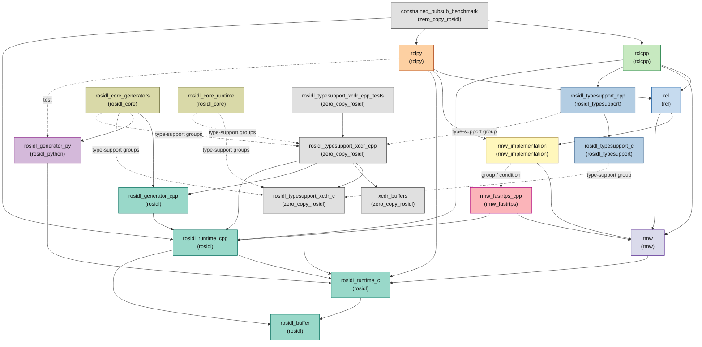

# REP-0157 Rolling migration

## Starting point

- The target is the current [REP-0157 draft](../reps/_posts/rep-0157:2026.md)
  (last updated at `reps` commit `19e3567`), not a straight Jazzy port.
- Infrastructure is at `zero_copy_rosidl` commit `c10375a`. The ten ROS
  repositories listed in [Rolling's patched manifest](code/core/.repos/rolling/patched.repos)
  are clean, on `zero-copy-rolling`, and at their manifest pins. Baseline
  builds have not yet been verified.
- The Jazzy PoC is under `code/core/jazzy/ros2/`; its corresponding
  `zero-copy-jazzy` branches are also available in the Rolling checkouts.
  The shared [XCDR packages](code/rosidl_typesupport_xcdr/) and
  [benchmark](code/constrained_pubsub_benchmark/) are tracked by this repo.
- `code/core/` checkouts are separate, ignored Git repositories. Track their
  changes and commits separately; update the Rolling manifest to reproducible
  ported revisions when they are available. `code/import.py` skips existing
  checkouts and does not update them.

Work bottom-up in the order below. Each checkbox is a separately verifiable
update; mark it complete only when its stated checks pass. A step is complete when all its
checkboxes pass; stop after each step and ask the user to commit to git.

## Contracts to preserve

- Existing member-based messages and APIs remain available. New views use
  method-based access and the `views` namespace or language equivalent.
- A view may own storage or borrow it. A borrowed view and its member
  references must not outlive the loan. Exactly one of destroy or release
  consumes the view; querying storage does not.
- Endpoint constraints are the baseline; a per-loan context may tighten but
  not loosen it. Publisher and subscriber baselines are independent. An
  omitted per-take constraint does not remove the subscription baseline.
- Storage comprises one or more regions. Start with CPU-backed XCDRv1; do not
  invent portable device-attribute or synchronization semantics. Unsupported
  context requirements and loans must be reported, not silently ignored.
- The REP does not standardize a wire format or type-support operation table.
  The PoC's XCDR table and in-place compaction are implementation choices.
  Compatible ordinary ROS communication and copy paths must continue working.

## Package dependencies

This is a simplified graph of the current Rolling
workspace: each node names a package and its repository, and colors identify
repositories. Arrows point from a package to its dependency. Dotted arrows
mark test dependencies or dependencies selected through package groups and
conditions. Build, runtime and test dependencies are included; unrelated
packages and transitive edges are omitted.



For example, `rosidl_generator_tests` selects interface packages such as
`action_msgs`, which depend on `rosidl_core_generators`. Its type-support
groups include the XCDR packages, so those packages can be selected even when
testing ordinary message generation.

## Ordered work

### 1. Contracts and plain-message adapters

- [x] Add experimental C region, constraint and context descriptors and C++
  region and constraint helpers; compile and test their basic use.
- [x] Generate method-based views adapting owned, borrowed and const plain
  messages; test ownership, mutability, moves and const-rvalue ownership.
- [x] Generate nested-message and sequence accessors and constraint checks;
  test the current plain-message cases and ordinary-message builds.
- [x] Remove the unnecessary `ament_cmake_ros` dependency from the shared XCDR
  C package and declare its GoogleTest dependency; build and test on Jazzy.
- [x] Complete the experimental lifetime interfaces for querying and
  consuming views without requiring an XCDR representation. Specify ownership
  and invalidation for borrowed storage and member references; test the
  contract independently of middleware.
- [x] Test plain-message constraints for nested and bounded strings/sequences,
  zero/unset limits and rejected looser bounds, plus lifetime invalid-use
  cases. Do not claim that plain-message adapters make storage transferable
  without copying.

Starting points: Jazzy `rosidl_runtime_{c,cpp}` and
`rosidl_generator_cpp/resource/*experimental*`.

### 2. Region-backed primitives and XCDR buffers

- [ ] Port CPU region-backed scalar and fixed-array primitives; test mutable
  and const access, bounds, invalid regions and owning versus borrowed storage.
- [ ] Port region-backed string and sequence primitives; test nested elements,
  capacity, malformed or undersized regions and lifetime independently of
  generated messages and middleware.
- [ ] Integrate storage exposure with `rosidl::Buffer` and Rolling's backend
  API; test owned and borrowed CPU storage and explicitly reject unsupported
  access rather than assuming device-memory semantics.
- [ ] Build `xcdr_buffers` on Rolling with its declared dependencies and run
  its layout, parser, accessor and Fast CDR interoperability tests. Check
  malformed input and preserve Jazzy compatibility in shared packages.

### 3. Generated region-backed views and XCDRv1 type support

The views can be built against region-backed primitives independently of
XCDR, but the XCDR generator needs their view and storage interfaces.
Verifying an XCDR-backed view requires both. Integrate and test them together
after Step 2 rather than requiring that verification before XCDR is ported.

- [ ] Adapt the XCDR C interface to the Rolling constraint contracts while
  retaining Jazzy compatibility; build and run its callback tests on both.
- [ ] Generate method-based views backed by the Step 2 primitives, alongside
  ordinary messages and plain-message adapters. Test nested fields, bounds,
  ownership and explicit mutability over controlled regions.
- [ ] Port XCDR C++ layout, construction and casting for those views; test
  compatible representations and reject malformed or undersized storage.
- [ ] Port storage query, destroy and release; test non-consuming queries,
  exactly-once consumption and simulated loan lifetime. Actual middleware
  loan return is verified in Steps 4 through 6.
- [ ] Port XCDR serialization and compaction and test ordinary-message copy
  interoperability. Keep format-specific logic in this implementation, not
  a purported format-independent ABI.
- [ ] Port necessary `rosidl_typesupport` dispatch and `rosidl_core`
  integration; test ordinary support and verify constrained handles retain
  their constraints and derived metadata.

Starting points: `code/rosidl_typesupport_xcdr/` and the Jazzy
`rosidl_typesupport` and `rosidl_core` branches.

### 4. Middleware context plumbing

- [ ] Add context-aware endpoint creation and borrow/take operations in `rmw`;
  test unsupported requirements and retained context/constraint lifetime.
- [ ] Forward the operations through `rmw_implementation`; test dispatch and
  preserve old entry points.
- [ ] Expose the operations in `rcl`; test existing APIs, independent endpoint
  baselines, tighter and rejected looser loans, and null per-loan context.

### 5. Fast DDS transport

- [ ] Port `rmw_fastrtps` XCDR type support against the pinned Rolling Fast
  DDS APIs; test compatible casts and incompatible representations.
- [ ] Port publisher endpoint and loan handling, including backing-region
  correlation and in-place finalization; test return and error cleanup.
- [ ] Port subscriber loans for plain and non-plain samples; test loan return,
  error cleanup and ordinary serialization/copy interoperability. Unsupported
  zero-copy is not evidence that an automatic fallback exists.

Starting point: Jazzy `rmw_fastrtps_shared_cpp` `XcdrTypeSupport` and loan paths.

### 6. C++ client library

- [ ] Port `rclcpp` endpoints and publisher loans for views and contexts;
  test existing APIs and return-on-error.
- [ ] Port subscription/executor support; test callback and loan lifetime.
- [ ] Demonstrate C++ to C++ publisher and subscriber loans, mixed loan/copy
  paths and ordinary-message communication.

### 7. Python bindings and client library

- [ ] Adapt `rosidl_python` generation and `MessageTypeBridge` to view APIs,
  constraints and lifetimes, reusing C++ XCDR; test ordinary Python messages.
- [ ] Port `rclpy` context and loan handling; test cleanup and callback
  lifetime without changing ordinary Python messages.
- [ ] Test C++ to Python, Python to C++, and Python to Python, including loan
  cleanup and subscriber callback lifetime. No separate CPython XCDR package
  is needed for the existing bridge approach.

### 8. Remaining language and service surface

- [ ] Provide C view types and accessors alongside existing C messages.
- [ ] Extend the view and constraint abstractions to service requests and
  responses; assess and implement the required client/middleware plumbing.
  The Jazzy topic PoC does not establish end-to-end service support, and its
  Python bridge excludes service/action constituents.
- [ ] Test applicable C and service paths, including ordinary-message
  compatibility and ownership.

### 9. End-to-end verification and documentation

- [ ] Port the benchmark to the new APIs and Rolling; run its smoke test and
  representative C++/Python copy and loan cases. Verify the actual transport
  and storage path when claiming zero-copy; compare with ordinary ROS peers.
- [ ] Run relevant package tests and regression tests; update the README,
  developer guides, Rolling manifests and CI/build instructions with verified
  commands and limitations.

## Development environment

Perform development builds, tests, and dependency installation in the matching
distribution's development container, not on the host. Edit the bind-mounted
sources from either environment. Use the Rolling development container for
this migration; use the Jazzy development container when checking Jazzy.

The Rolling container is selected explicitly:

```bash
./docker/run.sh --distro rolling --build --service dev_environ -- true
./docker/run.sh --distro rolling --service dev_environ -- bash
```

In the container, `/home/developer/code/import.py` imports missing Rolling
sources without replacing existing checkouts. Build and test the smallest
affected package set with `colcon` at each step. The Jazzy README commands and
the benchmark cannot be assumed to work on Rolling before their ports.
