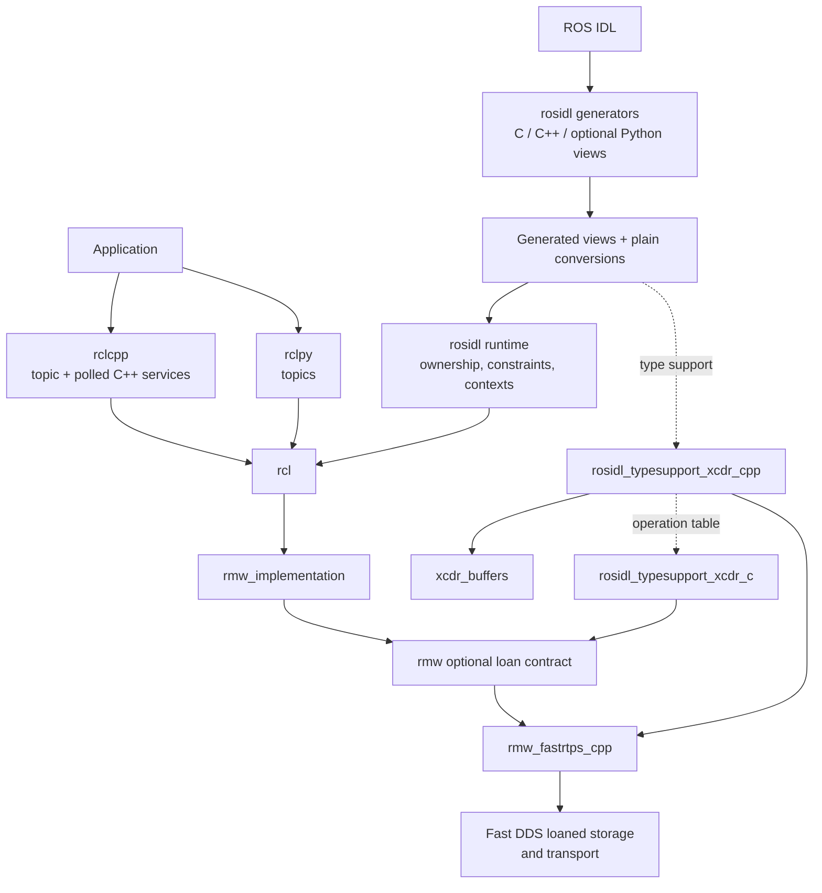
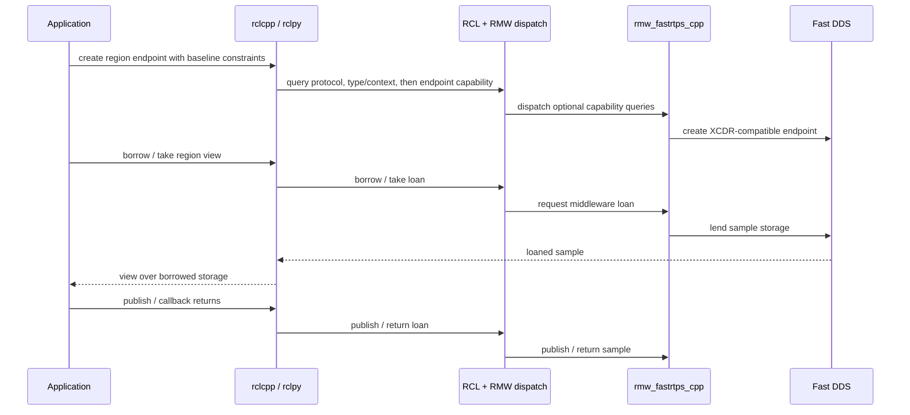
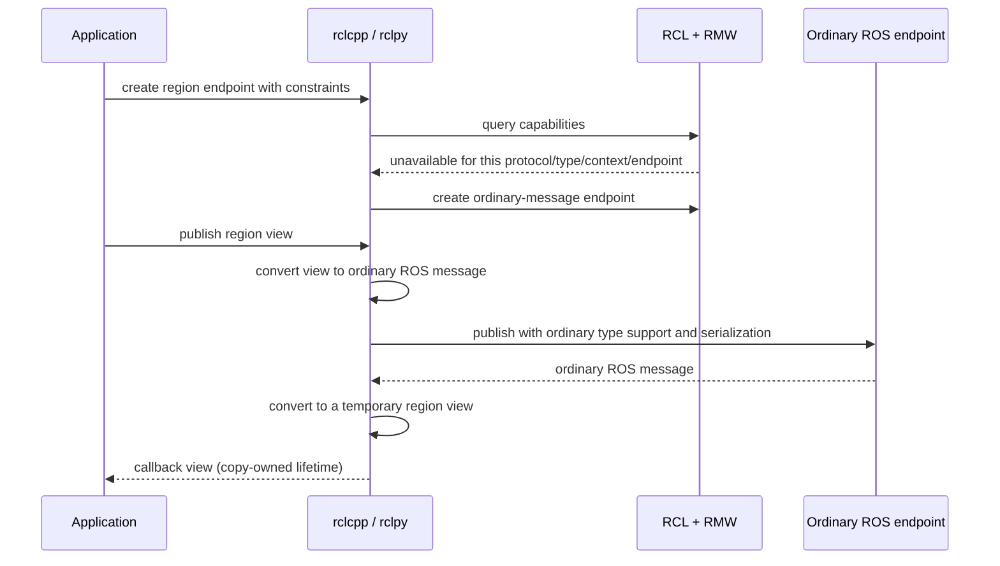

# Rolling region-view port: architecture and operating guide

This guide explains the experimental Rolling implementation in this repository:
how its packages fit together, which path a message takes, how ordinary ROS
peers remain compatible, how to build and measure the implementation, and what
is still needed before upstreaming. It describes the current implementation,
not a finalized REP-0157 API or a guarantee of end-to-end zero-copy.

For the migration history and verified implementation commits, see
[ROLLING_MIGRATION.md](ROLLING_MIGRATION.md). For detailed benchmark options
and data interpretation, see the [benchmark runbook](code/constrained_pubsub_benchmark/BENCHMARK_RUNBOOK.md).

## What is implemented

- Generated C, C++, and opt-in Python region views use owned or borrowed
  storage. A borrowed view and its references are valid only while its loan is
  alive.
- ROSIDL type support describes the XCDR layout. `xcdr_buffers` provides the
  layout and serialization helpers used by that implementation.
- Context-aware RCL/RMW APIs carry endpoint constraints and support topic and
  service loans. Fast DDS implements the native XCDR loan path.
- `rclcpp` and `rclpy` topic region APIs, and the C++ region service wrappers,
  select an ordinary-message copy path when a native loan is unavailable.
- Ordinary ROS message APIs and serialization remain available. Native
  Fast-DDS communication uses XCDRv1; the XCDR representation preserves the
  existing ROS wire representation, including wide strings.

Native support is conditional. A type, context, or endpoint may not be
loanable; an endpoint's `can_loan_messages` reports the selected native path,
not a guarantee that every operation succeeds or that the whole application
avoids copies. Genuine errors are surfaced; they are not treated as a reason to
retry an operation through a different path.

## Package and dependency map

This is the feature path, rather than a complete ROS package graph. Arrows
indicate dependencies or calls; dotted edges indicate generation/type-support
registration rather than runtime message flow.



The XCDR packages are part of this experimental repository; the other
repositories are separate ROS checkouts imported from the Rolling manifests.
The [pinned Rolling manifest](code/core/.repos/rolling/patched.repos) selects
the current port commits for the ten modified ROS repositories. It does not
update already-existing checkouts.

## Runtime data flow

### Native XCDR loan



The endpoint context establishes a baseline for all operations; a per-loan
context may tighten, but not loosen, it. For writers, the effective context
must provide enough finite bounds to allocate the serialized layout. If a
writer context cannot be bounded, the high-level region API selects copying.
Readers and writers are checked independently, and service request and
response contexts are independent.

The implementation formats the message in the loaned storage using its XCDR
layout and compacts variable-size fields in place when needed. This avoids
constructing a separate ordinary message on the selected native path, but it
does not guarantee that application assignments, transport, or every
middleware operation are copy-free. In Python in particular, assigning payload
values can still copy them into the loaned sequence.

### Transparent ordinary-message copy path



Capability absence is a normal selection result for high-level region APIs;
invalid arguments, endpoint creation failures, and other middleware errors are
not. Low-level context-aware C, RCL, and RMW loan operations are loan contracts,
not transparent adapters, and can report that loans are unsupported.

## Compatibility and path selection

| Local endpoint | Peer | Expected path and compatibility |
| --- | --- | --- |
| Region publisher or subscriber, Fast DDS, supported type/context | Ordinary ROS publisher or subscriber with the same ROS type | Native XCDRv1 loan path is intended to interoperate with the ordinary wire representation. |
| Region publisher or subscriber with no usable native loan capability | Ordinary ROS endpoint with the same ROS type | High-level C++/Python topic APIs and C++ region services use ordinary-message conversion and normal type support. |
| Ordinary ROS endpoint | Ordinary ROS endpoint | Existing message and serialization path; region support is not required. |
| Region endpoint with unsupported middleware or unsupported type/context | Ordinary ROS peer | Copy fallback is selected where the high-level adapter exists; the RMW implementation does not need to implement native loans. |
| Context-aware low-level loan call without middleware support | Any | Reports unsupported/error; it does not silently become a copy operation. |
| Either endpoint with a different or incompatible ROS type/schema | Any | Not made compatible by region views or fallback. |

Fast DDS native support is specifically XCDRv1. A lack of a protocol entry
point, unsupported type/context, or endpoint capability selects fallback for
the high-level APIs. A positive capability query is not a promise against
subsequent ordinary runtime errors. The Cyclone DDS fallback path has been
verified; native loans on other RMWs are not integrated by this port.

## Core components and quirks

| Component | Responsibility | Important boundary |
| --- | --- | --- |
| Generated region views | Language-facing accessors and conversion to/from plain messages. | Views can borrow storage. Do not retain a borrowed view or a member reference past its loan/callback lifetime. |
| `rosidl_runtime_*` views and contexts | Storage ownership, constraints, sequence/string access, and message contexts. | Baseline constraints remain in force; per-operation contexts only tighten them. |
| `rosidl_typesupport_xcdr_*` | Generated per-type layout operations and the C type-support operation table. | This is an implementation-specific XCDR policy, not a standardized REP-0157 type-support contract. |
| `xcdr_buffers` | XCDR layout, reading/writing and compaction over message regions. | The port uses XCDRv1 and existing ROS wire encoding. Wide strings expose a UTF-16 logical API while retaining the existing 32-bit wire representation. |
| `rmw` and `rmw_implementation` | Optional protocol/type/endpoint capability queries and dispatch. | Missing optional support is unavailable; invalid inputs and real errors remain errors. |
| `rmw_fastrtps_cpp` | Fast DDS loan and XCDR integration for topic and service roles. | Writer storage needs finite effective bounds. Other RMWs currently use the copy path rather than this native implementation. |
| `rclcpp` | Region publisher/subscription APIs and polled C++ region client/service wrappers. | Region subscriptions do not support intra-process communication. Region services are explicitly polled and are not registered with an executor. |
| `rclpy` | Python region publisher/subscription bindings and generated-view bridge over the C++ XCDR view support. | There is no separate CPython XCDR type-support package. Python region service/action views are not implemented. Generated Python views must be built with the option enabled for relevant interfaces and nested dependencies. |
| Benchmark | Copy and constrained-loan comparison cases plus CSV analysis/report generation. | Rolling supports three cases, not the five Jazzy cases; its available copy baseline does not isolate the effect of loans from the serialization backend. |

Additional constraints and behavior to account for:

- Context-aware endpoint creation is not automatically retried after a real
  creation error. If a successfully created endpoint later reports that it
  cannot loan, the high-level adapter recreates it using ordinary type
  support. Errors during creation, capability querying, conversion, or loan
  operations are surfaced.
- Copy fallback preserves type-specific constraints and checks converted
  messages. It is not an unlimited escape hatch: blanket constraints are not
  supported, and invalid data is reported/dropped according to the client
  library path.
- Python generation is opt-in with
  `ROSIDL_GENERATOR_PY_REGION_VIEWS=ON`. Generated view modules and the
  extended `rclpy` bridge must be built together; the bridge rejects
  incompatible older generated modules.
- The native representation and serialization implementation are currently
  coupled to XCDRv1. This is a practical reference backend, not evidence that
  REP-0157 should mandate XCDR or that all storage architectures fit this
  mapping.
- `shmem_ds` configures Fast DDS data sharing as `AUTOMATIC`. A successful
  sample or a report labeled `shmem_ds` does not establish that DDS data
  sharing was selected, nor that the sample was end-to-end zero-copy.

## Build and smoke-test on Rolling

Use the Rolling development container. It builds ROS from source and does not
provide `/opt/ros/rolling/setup.bash`.

```bash
# From the repository root; first command builds the image.
./docker/run.sh --distro rolling --build --service dev_environ -- true
./docker/run.sh --distro rolling --service dev_environ -- bash

# In a fresh container workspace. The importer skips existing checkouts.
cd /home/developer/ws
/home/developer/code/import.py

# Build the benchmark workspace with optional Python region views disabled.
MAKEFLAGS=-j2 colcon build --executor sequential \
  --packages-up-to constrained_pubsub_benchmark \
  --cmake-args -DCMAKE_BUILD_TYPE=Release \
  -DROSIDL_GENERATOR_PY_REGION_VIEWS=OFF

# The Python benchmark uses sensor_msgs/msg/Image and its nested interface
# dependencies. Enable Python region views only for that interface closure.
MAKEFLAGS=-j2 colcon build --executor sequential \
  --packages-up-to sensor_msgs \
  --cmake-args -DCMAKE_BUILD_TYPE=Release \
  -DROSIDL_GENERATOR_PY_REGION_VIEWS=ON
source /home/developer/ws/install/setup.bash

# Smoke-test the native path without requiring the ros2cli package.
BIN=install/constrained_pubsub_benchmark/lib/constrained_pubsub_benchmark
python3 "$BIN/inter_proc_benchmark.py" \
  --direction cpp_to_cpp --message exp --config constrained_pub_sub \
  --backend xcdr --transport udp --payload-bytes 4K \
  --publish-rate-hz 10 --duration-sec 3 --grace-sec 1 \
  > /tmp/rolling-smoke.csv 2> /tmp/rolling-smoke.log
```

For a reproducible fresh import, use the manifest-pinned revisions and an empty
workspace; `code/import.py` intentionally does not update existing checkouts.
The broader migration tests and their exact commit history are recorded in
[ROLLING_MIGRATION.md](ROLLING_MIGRATION.md). The root README's build commands
and the prebuilt comparison images are Jazzy-oriented; do not use them as a
Rolling setup recipe. The checked-in CI workflow also uses the default Jazzy
containers; it does not currently verify Rolling.

## Benchmark runs and comparable reports

The Rolling benchmark cases and a repeatable reduced sweep are documented in
[the Rolling comparison section of the runbook](code/constrained_pubsub_benchmark/BENCHMARK_RUNBOOK.md#11-rolling-comparison-and-reports).
The short version:

1. Build and source the Rolling workspace, set
   `RMW_IMPLEMENTATION=rmw_fastrtps_cpp`, and use the exact same payload,
   frequency, transport, direction, reliability, duration, and host state for
   each case.
2. Save each run's raw CSV and stderr log in one result directory. Use the
   three Rolling-supported cases:
   `std_copy_fastcdr`, `exp_constrained_pub_only_xcdr`, and
   `exp_constrained_pub_sub_xcdr`.
3. Generate one report over that directory with the analyzer, filtering to the
   same cases, transport(s), and direction(s). The analyzer writes per-run and
   aggregate CSVs plus `report.md` and figures.
4. Record the full revisions and environment with the result set: this repo
   and every imported ROS checkout, ROS/RMW/Fast DDS configuration, OS/kernel,
   CPU/frequency and idle-state policy, memory, transport profile, and exact
   commands. Keep the unmodified raw CSVs.

The report compares measured configurations, not a controlled isolated
"benefit of zero-copy." Rolling does not expose the Jazzy `std+copy+XCDR` or
`exp+copy+XCDR` baselines, so comparing its standard FastCDR copy case with a
constrained XCDR case changes both the data path and serialization backend.
Do not attribute the full difference to loans. Also, a selected native loan
does not imply that application field assignment or DDS transport avoided
every copy. For `shmem_ds`, the report label alone is not proof of data-sharing
use.

## Upstream work remaining

Treat these as design and integration work, not as claims that the current
port is ready to merge unchanged:

1. **Standardize the contract.** Propose and review public ownership/lifetime,
   region attributes, constraints, error, and optional capability semantics
   through REP and ROS interface governance. Keep the REP storage contract
   independent from this XCDR operation table.
2. **Separate storage from wire policy.** Specify how alternate storage
   backends and serializers implement views without making XCDR layout a
   universal representation. Define how encoding negotiation and
   ordinary-peer interoperability work beyond this XCDRv1 implementation.
3. **Complete implementations and API coverage.** Port and validate native
   support or the specified fallback for additional RMWs; integrate region
   services with executors; decide and implement Python service/action
   coverage; document unsupported intra-process behavior.
4. **Strengthen compatibility and lifetime tests.** Expand cross-RMW and
   ordinary-peer tests across bounded/unbounded fields, nested messages,
   strings, wide strings, services, encodings, endpoint recreation, and
   error paths. Include misuse/lifetime checks for C++, Python, and C.
5. **Make performance claims comparable.** Add a Rolling ordinary-message
   XCDR copy baseline (or another controlled design) so loans can be compared
   while keeping schema, encoding, transport, QoS, and process direction
   constant. Instrument whether Fast DDS data sharing was actually selected;
   run repeated trials with recorded hardware and system state.
6. **Prepare maintenance and release integration.** Rebase the patch series
   onto the intended upstream revisions, agree on package ownership and
   dependency direction, add supported-distro CI and build/test coverage,
   stabilize generated APIs/ABI, and publish migration examples and limits.

